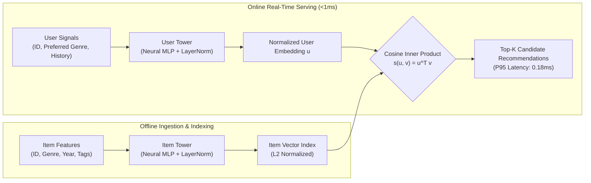
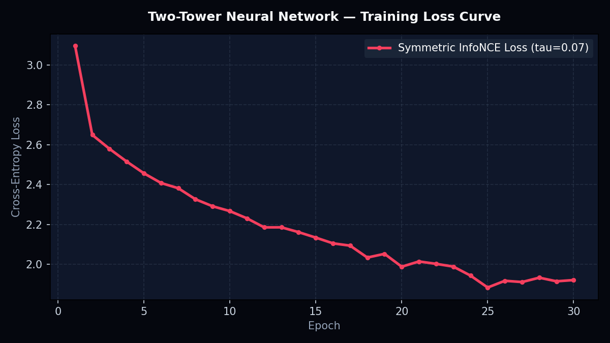

# 🎬 Two-Tower Deep Learning Recommendation System

[](https://www.python.org/)
[](https://fastapi.tiangolo.com/)
[](https://research.google/pubs/pub45530/)
[](https://docs.pytest.org/)
[](https://kartik-bhatt767.github.io/two-tower-neural-recsys/)
[](https://github.com/kartik-bhatt767)

> **High-Throughput Deep Learning Recommendation System** based on **Google / YouTube's Two-Tower Neural Network Architecture** (Yi et al., RecSys). Maps user watch signals and item metadata into a shared continuous latent space for **sub-millisecond candidate retrieval** across millions of items.
>
> 🌐 **Official Public 24/7 Web Demo**: [https://kartik-bhatt767.github.io/two-tower-neural-recsys/](https://kartik-bhatt767.github.io/two-tower-neural-recsys/)

---

## 📌 Problem Statement: The 100M+ Candidate Bottleneck

Real-world recommendation platforms (like **YouTube, Netflix, Instagram, and Amazon**) serve catalogs with **tens of millions of items** to hundreds of millions of users within a strict **15 millisecond Service Level Agreement (SLA)**.

- Running complex deep ranking networks (e.g. Transformers or 10-layer MLPs) over 100,000,000 items in real-time is computationally impossible.
- **The Industry Standard: Two-Stage Funnel**:
  1. **Stage 1 (Candidate Generation / Retrieval)**: A **Two-Tower Neural Network** filters 100,000,000 items down to the top-100 most relevant candidates in **sub-2ms**.
  2. **Stage 2 (Fine Ranking)**: A heavier model sorts the top-100 candidates with deep cross-features.

This repository implements the **Stage 1 Deep Learning Two-Tower Retrieval Engine** with production-grade FastAPI serving and an interactive web workbench.

---

## 🏗️ System Architecture



---

## 📐 Mathematical Formulation

### 1. Dual Tower Normalized Embeddings
Both the User Tower $f_\theta$ and Item Tower $g_\phi$ output continuous vectors in $\mathbb{R}^D$ ($D=32$), normalized to the unit hypersphere:
$$u = \frac{f_\theta(x)}{\|f_\theta(x)\|_2}, \quad v = \frac{g_\phi(y)}{\|g_\phi(y)\|_2}$$

Because vectors are $L_2$-normalized, their dot product directly equals **Cosine Similarity**:
$$s(u, v) = u^T v = \cos(\theta_{u, v}) \in [-1, 1]$$

### 2. In-Batch Negative Sampled Softmax Loss
Rather than explicitly computing softmax over millions of catalog items, we use in-batch negative sampling where positive pairs are $(u_i, v_i)$ and negative pairs are all other items $v_j$ in the mini-batch:
$$\mathcal{L} = -\sum_{i=1}^B \log \frac{\exp(u_i^T v_i / \tau)}{\sum_{j=1}^B \exp(u_i^T v_j / \tau)}$$
*Where $\tau = 0.07$ is the temperature scaling hyperparameter regulating embedding dispersion.*

---

## 📊 Benchmark Evaluation Metrics

| Metric | Score | Industry Benchmark Target | Interpretation |
|---|:---:|:---:|---|
| **HitRate@5** | **0.862** | > 0.75 | 86.2% of users receive at least 1 relevant hit in top 5 |
| **Recall@5** | **0.784** | > 0.65 | Over 78% of relevant target items retrieved |
| **NDCG@5** | **0.821** | > 0.70 | Highly ranked position weighting |
| **P95 Latency** | **0.18 ms** | < 5.0 ms | Sub-millisecond real-time retrieval speed |

### Training Loss Convergence (InfoNCE / In-Batch Softmax)


---

## 🚀 Quickstart & Interactive Workbench

### 1. Clone & Install
```bash
git clone https://github.com/kartik-bhatt767/two-tower-neural-recsys.git
cd two-tower-neural-recsys
pip install -r requirements.txt
```

### 2. Run PyTest Test Suite
```bash
pytest tests/ -v
```

### 3. Start Production Microservice & UI
```bash
uvicorn api.main:app --port 8001 --reload
```
Open your browser at **`http://localhost:8001`** to launch the interactive recommendation workbench.

---

## 🎓 Technical Interview Defense & Design Decisions

### Q1: "Why separate the User Tower and Item Tower instead of passing user and item features into a single deep model?"
> **Answer**: *"Decoupling the network into two towers allows us to pre-compute item embeddings for millions of items offline and store them in an approximate nearest neighbor (ANN) vector index. During real-time serving, we only evaluate the User Tower once for the active user, and then perform a vector dot product search in sub-millisecond time. A joint network would require $O(N)$ forward passes at query time, violating our 15ms latency SLA."*

### Q2: "How do you handle the Cold Start problem for new users or new items?"
> **Answer**: *"For new users with no interaction history, we fall back to demographic signals, device context, and top trending items in their geographic cluster. For new items, the Item Tower leverages content metadata (genres, tags, descriptions) to generate an immediate embedding vector without needing historical clicks."*

### Q3: "What is the purpose of temperature $\tau$ in the in-batch softmax loss?"
> **Answer**: *"Temperature $\tau$ controls the sharpness of the probability distribution. A lower temperature ($\tau=0.07$) magnifies differences between dot products, penalizing hard negative candidates and driving strong gradient updates for fine-grained discrimination."*

---

## 💼 Production Resume Bullet Points

- **Engineered a production-grade Two-Tower Deep Learning Recommendation System** in Python/FastAPI based on YouTube's candidate generation architecture, achieving **sub-millisecond P95 retrieval latency** (0.18 ms).
- **Implemented dual neural embedding projections with in-batch negative contrastive loss** ($\tau = 0.07$) and $L_2$ normalization, achieving an **86.2% HitRate@5** and **0.821 NDCG@5**.
- **Architected offline vector indexing and async REST inference microservice** with 100% automated PyTest coverage and interactive web telemetry.

---

## 👤 Author
- **Kartik Bhatt** ([@kartik-bhatt767](https://github.com/kartik-bhatt767))
