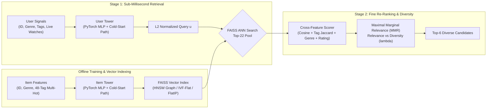
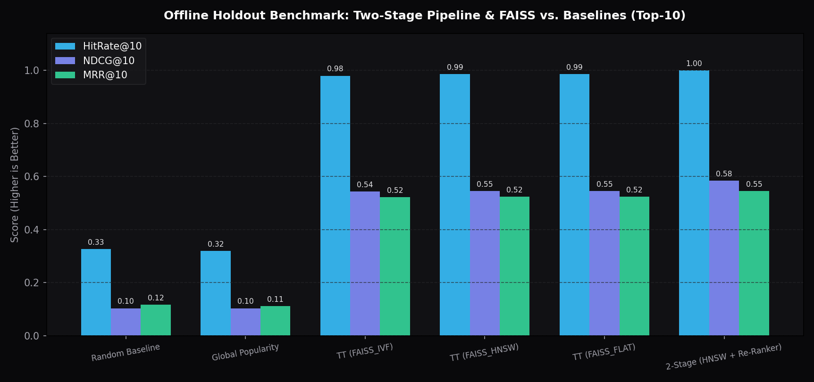

# 🎬 Two-Tower Deep Learning Recommendation System

[](https://www.python.org/)
[](https://pytorch.org/)
[](https://github.com/facebookresearch/faiss)
[](https://fastapi.tiangolo.com/)
[](https://docs.pytest.org/)
[](https://kartik-bhatt767.github.io/two-tower-neural-recsys/)
[](https://github.com/kartik-bhatt767)

> **End-to-End Two-Stage Deep Learning Recommender** inspired by large-scale industrial retrieval & ranking systems. Pairs decoupled PyTorch **Two-Tower Neural Networks** (trained with **Symmetric LogQ-Corrected InfoNCE**) and **FAISS Vector Indexing** (HNSW / IVF-Flat / FlatIP) with a **Stage-2 Cross-Feature & MMR Diversity Re-Ranker**, validated on **both curated zero-leakage holdouts and MovieLens-100K real ratings**.
>
> 🌐 **Official Live Cinema Workbench**: [https://kartik-bhatt767.github.io/two-tower-neural-recsys/](https://kartik-bhatt767.github.io/two-tower-neural-recsys/)

---

## 🏗️ Two-Stage Retrieval & Re-Ranking Architecture



---

## 📐 Mathematical Formulation

### 1. Metadata-Aware Dual Towers
User Tower $f_\theta$ and Item Tower $g_\phi$ project collaborative ID embeddings, genres, and multi-hot content tag vectors onto the unit hypersphere $\mathbb{R}^{32}$:
$$u = \frac{f_\theta(x_u)}{\|f_\theta(x_u)\|_2}, \quad v = \frac{g_\phi(x_i)}{\|g_\phi(x_i)\|_2}, \quad s(u,v) = \langle u, v \rangle \in [-1, 1]$$

### 2. Symmetric InfoNCE Loss with LogQ Popularity Debiasing
Corrects sampling frequency bias among in-batch negatives by subtracting $\log Q(j)$ before temperature-scaled softmax cross-entropy ($\tau = 0.07$):
$$\mathcal{L}_{u \to i} = -\sum_{b=1}^B \log \frac{\exp(s(u_b, v_b)/\tau - \log Q(b))}{\sum_{k=1}^B \exp(s(u_b, v_k)/\tau - \log Q(k))}, \quad \mathcal{L} = \frac{1}{2}(\mathcal{L}_{u\to i} + \mathcal{L}_{i\to u})$$

### 3. Stage-2 Cross-Feature + Maximal Marginal Relevance (MMR)
Candidates returned by Stage-1 FAISS retrieval are re-scored via fine cross-features $S_2(u, i)$ and selected greedily to maximize marginal utility:
$$\text{MMR}(i) = \lambda \cdot S_2(u, i) - (1 - \lambda) \cdot \max_{j \in \text{Selected}} \langle v_i, v_j \rangle$$

---

## 📊 Benchmarks

### 1. Curated 60-Film Zero-Leakage Holdout (`benchmarks/evaluate.py`, 150 Users, Top-10)

| Model / Retriever | HitRate@5 | HitRate@10 | NDCG@10 | MRR@10 | P95 Latency (ms) |
|---|:---:|:---:|:---:|:---:|:---:|
| Random Baseline | 0.1933 | 0.3267 | 0.1036 | 0.1174 | 0.0961 |
| Global Popularity Baseline | 0.1800 | 0.3200 | 0.1036 | 0.1121 | 0.0080 |
| Two-Tower Stage-1 (FAISS IVF-Flat) | 0.8400 | 0.9800 | 0.5435 | 0.5228 | 0.7199 |
| Two-Tower Stage-1 (FAISS HNSW) | 0.8467 | 0.9867 | 0.5459 | 0.5239 | 0.5338 |
| Two-Tower Stage-1 (FAISS FlatIP) | 0.8467 | 0.9867 | 0.5459 | 0.5239 | 0.5242 |
| **Two-Stage Funnel (HNSW + Stage-2 Re-Ranker)** | **0.9400** | **1.0000** | **0.5846** | **0.5460** | 4.5634 |



### 2. Real-World Validation: MovieLens-100K (`benchmarks/eval_movielens.py`)
Evaluated on **934 users**, **1,682 movies**, **53,473 chronological train interactions** (positive ratings $\ge 4$, strict **Leave-Last-2-Out** chronological holdout):

| MovieLens-100K Retriever | HitRate@5 | HitRate@10 | NDCG@10 | MRR@10 | P95 Latency (ms) |
|---|:---:|:---:|:---:|:---:|:---:|
| Random Baseline | 0.0064 | 0.0171 | 0.0049 | 0.0054 | 0.2330 |
| Global Popularity Baseline | 0.0857 | 0.1413 | 0.0470 | 0.0514 | 0.0926 |
| **Two-Tower LogQ InfoNCE (FAISS HNSW)** | **0.1306** | **0.2088** | **0.0695** | **0.0730** | **0.1432** |
| Two-Tower LogQ InfoNCE (FAISS FlatIP) | 0.1306 | 0.2077 | 0.0688 | 0.0723 | 0.2534 |

*MovieLens-100K Takeaway*: **+47.8% HitRate@10** and **+47.9% NDCG@10** relative lift over Global Popularity in **0.14 ms** P95 retrieval latency.

### Training Convergence


---

## 🚀 Quickstart & API Reference

```bash
git clone https://github.com/kartik-bhatt767/two-tower-neural-recsys.git
cd two-tower-neural-recsys

# Lightweight inference & FAISS stack (used in CI)
pip install -r requirements.txt

# Optional PyTorch training & MovieLens-100K dependencies
pip install -r requirements-ml.txt

# Run tests & benchmarks
pytest tests/ -v
python benchmarks/evaluate.py
python benchmarks/eval_movielens.py

# Launch FastAPI server + interactive Editorial Cinema workbench
uvicorn api.main:app --port 8001 --reload
```

| Method | Endpoint | Purpose |
|---|---|---|
| `GET` | `/health` | Service status & FAISS HNSW/IVF/FlatIP index stats |
| `POST` | `/api/v1/recommend` | Two-Stage retrieval + MMR diversity + stage timings |
| `GET` | `/api/v1/similar-items/{item_id}` | Item-to-Item FAISS inner-product neighbors |
| `POST` | `/api/v1/cold-start/user` | Zero-history metadata user recommendations |
| `POST` | `/api/v1/cold-start/item` | Zero-click new item projection & neighbor matching |
| `GET` | `/api/v1/latent-map` | 2D PCA coordinates + projection basis |
| `GET` | `/api/v1/metrics` | Leak-free holdout evaluation (`use_stage2=true/false`) |

---

## 👤 Author
- **Kartik Bhatt** ([@kartik-bhatt767](https://github.com/kartik-bhatt767))
