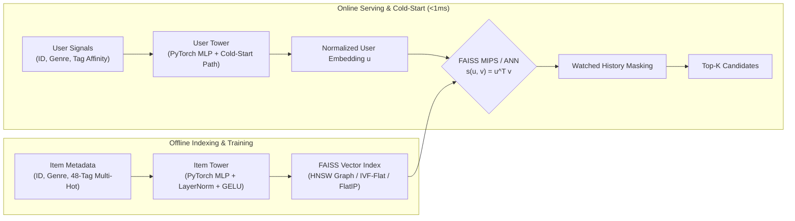

# 🎬 Two-Tower Deep Learning Recommendation System

[](https://www.python.org/)
[](https://pytorch.org/)
[](https://github.com/facebookresearch/faiss)
[](https://fastapi.tiangolo.com/)
[](https://docs.pytest.org/)
[](https://kartik-bhatt767.github.io/two-tower-neural-recsys/)
[](https://github.com/kartik-bhatt767)

> **High-Throughput Deep Learning Candidate Retrieval System** inspired by large-scale industrial recommender architectures (YouTube DNN / Two-Tower Retrieval). Projects User history + metadata and Item catalog features into an $L_2$-normalized 32D latent space for **sub-millisecond FAISS ANN retrieval**, complete with **Cold-Start inference** and a **strict zero-leakage holdout evaluation pipeline**.
>
> 🌐 **Official Public 24/7 Web Demo**: [https://kartik-bhatt767.github.io/two-tower-neural-recsys/](https://kartik-bhatt767.github.io/two-tower-neural-recsys/)

---

## 📌 Problem Statement: The Million-Candidate Retrieval Bottleneck

Large-scale content platforms serve catalogs of **tens of millions of items** within a strict **15 ms end-to-end SLA**. Evaluating a heavy cross-attention ranking network across every catalog candidate on every request is computationally infeasible ($O(N)$ deep forward passes).

The industrial standard solves this with a **Two-Stage Retrieval & Ranking Funnel**:
1. **Stage 1 — Candidate Generation (This Repository)**: Decoupled **Two-Tower Neural Networks** map users and items independently into a unified vector space, narrowing millions of candidates down to the Top-$K$ items in **$< 1\text{ ms}$** via **FAISS Approximate Nearest Neighbor (ANN)** search.
2. **Stage 2 — Fine Ranking**: Downstream rankers score only the Top-$K$ candidates using rich user-item cross-features.

---

## 🏗️ System Architecture



---

## 📐 Mathematical Formulation

### 1. Metadata-Aware Dual Tower Projections
Both the User Tower $f_\theta$ and Item Tower $g_\phi$ fuse collaborative ID embeddings with genre embeddings and projected multi-hot metadata tag vectors ($\mathbb{R}^{48}$), projecting them into $\mathbb{R}^{32}$ on the unit hypersphere:
$$u = \frac{f_\theta(x_u)}{\|f_\theta(x_u)\|_2}, \quad v = \frac{g_\phi(x_i)}{\|g_\phi(x_i)\|_2}$$
Because all embeddings lie on the unit hypersphere, inner product search directly yields Cosine Similarity:
$$s(u, v) = u^T v = \cos(\theta_{u,v}) \in [-1, 1]$$

### 2. Symmetric In-Batch Contrastive Loss (InfoNCE)
Trained strictly on training interactions (excluding unseen holdout items) using symmetric temperature-scaled softmax cross-entropy over in-batch negatives ($\tau = 0.07$):
$$\mathcal{L} = \frac{1}{2} \left( \text{CE}\!\left(\frac{UV^T}{\tau}, I\right) + \text{CE}\!\left(\frac{VU^T}{\tau}, I\right) \right)$$

### 3. Cold-Start Inference Paths
- **Cold-Start User** (`/api/v1/cold-start/user`): Substitutes the mean learned user prior concatenated with live genre and multi-hot tag vectors (`encode_cold_user`).
- **Cold-Start Item** (`/api/v1/cold-start/item`): Projects zero-click catalog additions purely from content genre and metadata tags (`encode_cold_item`).

---

## 📊 Offline Zero-Leakage Holdout Benchmarks

Evaluated across **150 users** and **60 enriched catalog items** using a strict **disjoint 75% Train / 25% Unseen Holdout split** (`benchmarks/evaluate.py`, Top-$K = 10$):

| Model / Retriever | HitRate@5 | HitRate@10 | NDCG@10 | MRR@10 | P95 Latency (ms) |
|---|:---:|:---:|:---:|:---:|:---:|
| Random Baseline | 0.1933 | 0.3267 | 0.1036 | 0.1174 | 0.0568 |
| Global Popularity Baseline | 0.1800 | 0.3200 | 0.1036 | 0.1121 | 0.0059 |
| **Two-Tower + FAISS IVF-Flat** | **0.8600** | 0.9733 | **0.5381** | 0.5110 | 0.9280 |
| **Two-Tower + FAISS HNSW** | **0.8600** | **0.9800** | 0.5365 | **0.5117** | 0.8189 |
| **Two-Tower + FAISS FlatIP** | **0.8600** | **0.9800** | 0.5365 | **0.5117** | **0.4185** |

*Key result*: **+66.0% HitRate@10 gain** and **5.18x NDCG@10 lift** over Global Popularity on completely unseen holdout targets.

### Offline Holdout Benchmark Comparison


### Symmetric InfoNCE Training Convergence


---

## 🚀 Quickstart & API Reference

### 1. Install Dependencies
```bash
git clone https://github.com/kartik-bhatt767/two-tower-neural-recsys.git
cd two-tower-neural-recsys
pip install -r requirements.txt
```

### 2. Run PyTest Verification & Benchmarks
```bash
pytest tests/ -v
python benchmarks/evaluate.py
```

### 3. Launch Production FastAPI Server & Interactive Workbench
```bash
uvicorn api.main:app --port 8001 --reload
```
Visit **`http://localhost:8001`** for the interactive UI (featuring Existing User Retrieval, Cold-Start Lab, FAISS Index Switcher, and 2D PCA Latent Space Map) or **`http://localhost:8001/docs`** for Swagger OpenAPI docs.

### Core Endpoints
| Method | Endpoint | Purpose |
|---|---|---|
| `GET` | `/health` | Service health & active FAISS index telemetry (`flat`, `hnsw`, `ivf`) |
| `POST` | `/api/v1/recommend` | Personalized candidate retrieval with stage latency breakdown |
| `POST` | `/api/v1/cold-start/user` | Metadata-only recommendations for zero-history users |
| `POST` | `/api/v1/cold-start/item` | Nearest-neighbor retrieval for brand-new zero-click items |
| `GET` | `/api/v1/latent-map` | 2D SVD/PCA coordinates of all 60 catalog item embeddings |
| `GET` | `/api/v1/metrics` | Live zero-leakage holdout evaluation (`HitRate@K`, `NDCG@K`, `MRR@K`) |

---

## 🎓 Technical Interview Defense & Design Decisions

### Q1: "Why separate the User Tower and Item Tower instead of feeding user and item features into one joint MLP?"
> **Answer**: *"Decoupling lets us pre-compute and index all item embeddings offline in FAISS (HNSW/IVF-Flat). At serving time, we run the User Tower forward pass once per request (~0.2 ms) and perform approximate inner-product search. A joint network requires $O(N)$ forward passes per request, failing real-time latency SLAs."*

### Q2: "How do you prevent train/test leakage in offline retrieval benchmarks?"
> **Answer**: *"Each user's interaction set is partitioned into disjoint `history_item_ids` (used during contrastive training and masked out before final ranking) and unseen `holdout_item_ids`. Evaluation metrics (`HitRate@K`, `NDCG@K`, `MRR@K`) measure retrieval strictly on held-out targets."*

### Q3: "How does your system solve Cold-Start for brand-new users and items?"
> **Answer**: *"Both towers fuse ID embeddings with dense projections of genre and 48-tag multi-hot vectors. Zero-history users call `encode_cold_user(genre, tags)` using the learned prior user center, and zero-click items call `encode_cold_item(genre, tags)` so they immediately populate the FAISS index."*

---

## 👤 Author
- **Kartik Bhatt** ([@kartik-bhatt767](https://github.com/kartik-bhatt767))
